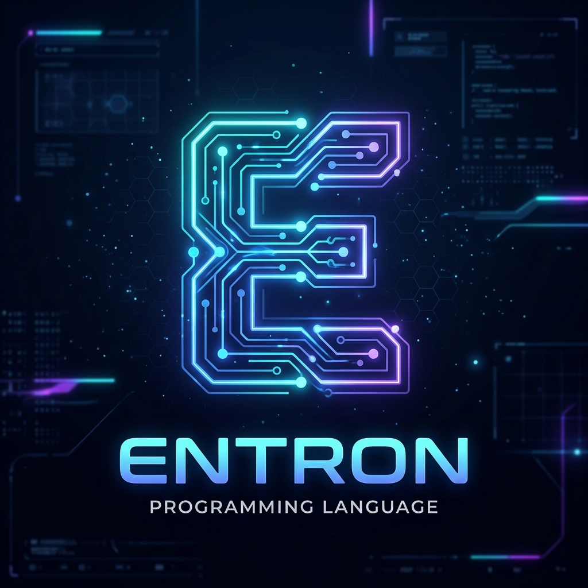

# ⚡ Entron Programming Language

<p align="center">
  
  
</p>

<p align="center">
  <strong>The super-simple, plain-English dynamic programming language.</strong><br>
  <em>No cryptic symbols. Natural syntax. Modern dynamic capabilities.</em>
</p>

---

## 🌟 What is Entron?

**Entron** is a modern dynamic programming language where **cryptic mathematical and punctuation symbols are replaced by expressive, plain English**. 

Instead of typing `x = (a + b) * c && d != null`, in Entron you write:
```entron
define variable x as a plus b times c and d is not nothing
```

Entron can do everything a modern dynamic language can do—variables, arithmetic, comparisons, complex conditionals, loops, first-class and recursive functions, dynamic lists, key-value records (dictionaries), string manipulation, file I/O, error handling with try/catch, asynchronous delays, and network fetching.

---

## 🚀 Quick Start

### Running Code with Entron CLI
You can run any Entron code directly using:

```powershell
entron run filename
```

For example:
```powershell
.\entron run examples\01_hello.entron
.\entron run examples\07_fizzbuzz.entron
```

You can also run directly with Bun or the compiled native executable:
```bash
# Using compiled native Windows binary
.\entron.exe run examples\05_functions.entron

# Using Bun runtime
bun run src/cli.ts run examples\05_functions.entron
```

### Interactive REPL
To start an interactive Entron session:
```powershell
.\entron repl
```
```
  ⚡ ENTRON PROGRAMMING LANGUAGE ⚡
  Version 1.0.0 - Plain English Dynamic Language
  Type 'exit' to quit, 'help' for examples.

entron> define variable name as "Developer"
entron> display "Hello " joined with name
Hello Developer
entron> display 15 times 4 plus 10
70
```

---

## 📖 Entron Language Syntax Guide

### 1. Comments
Lines starting with `note:`, `comment:`, or `--` are ignored:
```entron
note: This is a single line note
comment: Explaining the code logic
-- Also supported as a comment
```

### 2. Variables & Mutability
```entron
define variable score as 100
create greeting as "Hello World"
set score to 150

note: English mutation helpers:
add 25 to score
subtract 10 from score
change score by 5
```

### 3. Plain English Operators & Math
| Operation | Entron Plain English | Traditional Equivalent |
|---|---|---|
| Addition | `a plus b` | `a + b` |
| Subtraction | `a minus b` | `a - b` |
| Multiplication | `a times b` or `a multiplied by b` | `a * b` |
| Division | `a divided by b` | `a / b` |
| Modulo | `a modulo b` | `a % b` |
| String Concatenation | `a joined with b` | `a + b` |
| Negative Number | `negative 42` | `-42` |
| Square Root | `math square root of 144` | `Math.sqrt(144)` |
| Power | `math power of 2 to 8` | `Math.pow(2, 8)` |
| Absolute Value | `math absolute value of x` | `Math.abs(x)` |
| Random Number | `random number between 1 and 100` | `rand(1, 100)` |

### 4. Comparisons & Logic
```entron
if age is at least 18 and has_ticket then
    display "Access granted"
otherwise if age is less than 18 or not has_ticket then
    display "Access denied"
otherwise
    display "Review required"
end if
```

#### Switch Statements
When comparing one value against many fixed options, `switch` is cleaner than a chain of `otherwise if`:
```entron
switch day
    case 1
        set label to "Monday"
    case 2
        set label to "Tuesday"
    otherwise
        set label to "Unknown"
end switch
```
Only the first matching branch runs (no fall-through), comparisons are strictly typed (number `2` does not match string `"2"`), case tests can be any expression (e.g. `case 40 plus 2`), and the `otherwise` branch runs when nothing matches.

Plain English comparisons available:
- `is equal to` (or `equals`)
- `is not equal to` (or `is not`)
- `is greater than`
- `is less than`
- `is at least` (greater than or equal to)
- `is at most` (less than or equal to)
- `contains`
- `and`, `or`, `not`

### 5. Loops
#### Repeat Loop
```entron
repeat 3 times
    display "Repeating message..."
end repeat
```

#### Count Loop
```entron
count from 1 to 5 as index do
    display "Current index: " joined with index
end count

note: With custom step:
count from 10 to 2 by negative 2 as step_num do
    display step_num
end count
```

#### While Loop
```entron
define variable timer as 1
while timer is at most 10 do
    if timer is equal to 5 then
        break loop
    end if
    add 1 to timer
end while
```

#### For Each Loop
```entron
define variable fruits as list containing "Apple" and "Banana" and "Cherry"
for each fruit in fruits do
    display fruit
end for
```

### 6. Functions & Recursion
```entron
define function calculateDiscount with price and rate
    define variable discount as price times rate
    define variable final_price as price minus discount
    return final_price
end function

define variable total as call calculateDiscount with 100 and 0.15
display "Final price: " joined with total
```

Recursive functions:
```entron
define function fibonacci with n
    if n is at most 0 then
        return 0
    end if
    if n is equal to 1 then
        return 1
    end if
    define variable n1 as n minus 1
    define variable n2 as n minus 2
    define variable r1 as call fibonacci with n1
    define variable r2 as call fibonacci with n2
    return r1 plus r2
end function
```

### 7. Lists & Collections
```entron
note: Creation
define variable numbers as list containing 10 and 20 and 30
define variable empty_items as empty list

note: Manipulation
append 40 to numbers
remove item at position 1 from numbers

note: Access & Queries
display "Length: " joined with length of numbers
display "First: " joined with first item of numbers
display "Last: " joined with last item of numbers
display "Position 2: " joined with item at position 2 of numbers
display "Sorted: " joined with sorted numbers
display "Reversed: " joined with reversed numbers

if numbers contains 20 then
    display "20 is present in the list!"
end if
```

### 8. Records (Dictionaries / Maps)
```entron
define variable user as record with key "name" as "Grace" and key "role" as "Engineer"

note: Read property
display value for key "name" in user

note: Write property
set key "country" in user to "USA"

note: Introspection
display keys of user
display values of user
```

### 9. File I/O
```entron
write "Hello file!" to file "log.txt"
append "Second line" to file "log.txt"

if file exists "log.txt" then
    define variable contents as ""
    read file "log.txt" into contents
    display contents
end if
```

### 10. Robust Error Handling
```entron
try
    define variable broken as 100 divided by 0
otherwise on error err
    display "Recovered safely from error: " joined with err
end try
```

### 11. Strings & Async Timers
#### String Interpolation
Embed any expression directly in a string with `{{ ... }}`—no manual concatenation needed:
```entron
define variable name as "Developer"
define variable score as 95

display "Hello {{ name }}!"
display "Your score: {{ score }} ({{ score divided by 2 }}%)"

note: Works everywhere strings do, including function arguments:
display "Greetings, {{ value for key "name" in user }}"
```
Placeholders are evaluated strictly (`{{ "2" }}` stays a string), and an unterminated `{{` is kept as literal text.

```entron
define variable str as "  Entron Language  "
display trimmed str
display uppercase of str
display lowercase of str
define variable items as split "a,b,c" by ","

note: Async timer
display "Waiting 250 milliseconds..."
wait 250 milliseconds
display "Done waiting!"
```

### 12. Built-In Servers (REST, WebSocket, GraphQL, MQTT)
Entron includes first-class, built-in servers requiring zero external dependencies:

#### A. REST API Server
```entron
define function handleApiRequest with request
    define variable path as value for key "path" in request
    if path is equal to "/api/status" then
        return record with key "status" as 200 and key "type" as "application/json" and key "body" as "{\"status\":\"healthy\"}"
    otherwise
        return record with key "status" as 404 and key "body" as "Not found"
    end if
end function

start http server on port 3000 with handler handleApiRequest
```

#### B. WebSocket Real-Time Server
```entron
define function onClientConnected with client_id
    send message "Welcome to Entron Real-Time WebSocket!" to socket client_id
end function

define function onClientMessage with client_id and message
    send message "Echo: " joined with message to socket client_id
end function

start websocket server on port 8080 with on open onClientConnected and on message onClientMessage
```

#### C. GraphQL Server
```entron
define variable schema as "type Query { hello: String, time: String }"
define variable resolvers as record with key "hello" as "Hello GraphQL!" and key "time" as "2026-10-19"

start graphql server on port 4000 with schema schema and resolvers resolvers
```
*Visiting `http://localhost:4000` in your browser opens the interactive Entron GraphQL Web Explorer!*

#### D. MQTT Message Broker Server
```entron
define function onMqttMessage with topic and payload
    display "Telemetry on " joined with topic joined with ": " joined with payload
    publish mqtt topic "ack/status" with payload "Received"
end function

start mqtt server on port 1883 with handler onMqttMessage
```

---

## 📂 Included Examples

Run any of the provided demonstration scripts in `examples/`:

| Script | Description |
|---|---|
| `examples/01_hello.entron` | Hello world, string joins, and greeting |
| `examples/02_variables_and_math.entron` | Arithmetic, power, square root, random numbers |
| `examples/03_conditionals.entron` | If-otherwise, comparisons, and logic |
| `examples/04_loops.entron` | Repeat, count, while, for-each, break & continue |
| `examples/05_functions.entron` | Functions, parameters, factorial & Fibonacci recursion |
| `examples/06_lists_and_records.entron` | List operations, dictionaries, keys, sorting |
| `examples/07_fizzbuzz.entron` | The classic FizzBuzz algorithm in plain English |
| `examples/08_file_io.entron` | File write, append, read, and existence checks |
| `examples/09_error_handling.entron` | Try-otherwise error handling and recovery |
| `examples/10_algorithms.entron` | Prime number sieve and sorting algorithms |
| `examples/11_strings_and_time.entron` | String parsing, trim, casing, and async timing |
| `examples/12_api_chatcopilot.entron` | HTTP GET request with headers and JSON parsing |
| `examples/13_rest_api_server.entron` | Full REST API server with JSON endpoints |
| `examples/14_websocket_server.entron` | Event-driven WebSocket server with real-time echoes |
| `examples/15_graphql_server.entron` | GraphQL server with schema, resolvers & web explorer |
| `examples/16_mqtt_broker_server.entron` | MQTT message broker on port 1883 with telemetry |
| `examples/17_switch.entron` | Switch statements, expressions in case tests, strict matching |
| `examples/18_string_interpolation.entron` | `{{ ... }}` string interpolation with variables, math, and records |

---

## 🧪 Testing

Run the full automated test suite:
```powershell
bun test
```
22 automated tests test lexing, parsing, runtime semantics, arithmetic, recursion, lists, records, error trapping, string manipulation, switch statements, string interpolation, and built-in REST and GraphQL servers.

---

## 📦 Building Standalone Binary

To compile Entron into a standalone, zero-dependency Windows executable:
```powershell
bun run build
```
This generates `entron.exe`, ready to run anywhere without requiring Bun or Node installed!

---

<p align="center">
  <strong>Entron — Bringing programming to everyone in clear, plain English.</strong>
</p>
